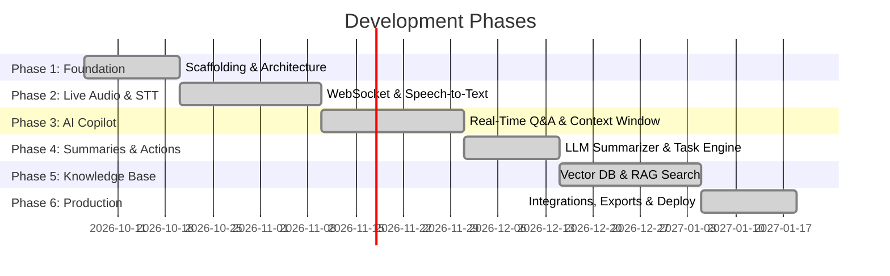

# 🗺️ Meeting Copilot - Project Roadmap

This document outlines the development phases, milestones, and release strategy for **Meeting Copilot**.

---

## 📅 Roadmap Overview

---

## 🎯 Detailed Milestone Plan

### 🚀 Phase 1: Core Foundation & Architecture
- [x] **Frontend Initialization**
  - Set up Next.js (App Router, TypeScript) with dark mode UI shell.
  - Build UI layout shell: Sidebar, Header, Active Meeting view, Dashboard.
- [x] **Backend Scaffolding**
  - Initialize FastAPI project with async standard structure.
  - Configure CORS, environment settings, and logging handlers.
- [x] **Data Models & Schemas**
  - Define Pydantic models for `Meeting`, `TranscriptSegment`, `ActionItem`, `Summary`.
  - Shared TypeScript contract definitions in `api/types.ts`.

---

### 🎙️ Phase 2: Live Audio Pipeline & Streaming STT
- [x] **Browser Audio Capture**
  - Build `useAudioRecorder` hook using Web Audio API & MediaRecorder.
  - Real-time base64 audio chunking (`webm_opus` format).
- [x] **WebSocket Streaming Core**
  - Establish persistent WebSocket connection between Client and FastAPI.
  - Connection management, heartbeat (`ping`/`pong`), and `sync_history` on reconnect.
- [x] **Speech-to-Text (STT) Integration**
  - Connect STT engines (Deepgram Nova-2 / OpenAI Whisper) with fallback realistic mock dialogue.
  - Stream transcript chunks with timestamps back to the frontend feed.
- [x] **Speaker Diarization**
  - Identify and separate different speakers in real-time or batch audio file uploads.

---

### 🤖 Phase 3: In-Meeting AI Copilot & Real-Time Assistance
- [x] **Context Manager Service**
  - Implement rolling transcript buffer to feed LLM context window.
- [x] **In-Meeting Copilot Chat**
  - Interactive panel for asking questions during live meetings.
  - Instant answers with timestamp citations based on meeting context so far.
- [x] **Real-time AI Copilot Engine**
  - Live Q&A answering engine powered by Gemini, OpenAI, or dynamic context search.
  - Auto-extract action items, assignees, and deadlines.
- [x] **Smart Proactive Nudges**
  - Auto-suggest follow-up questions and highlight unaddressed agenda topics.

---

### 📝 Phase 4: Automated Summarization & Action Item Engine
- [x] **Meeting Summarizer Service**
  - Generate structured executive summaries with key topics and decisions.
- [x] **Action Item Extractor**
  - Detect action items, assignees, priorities, and deadlines automatically.
  - Inline editing and checkbox status toggle via REST API (`PATCH /api/meetings/{id}/action-items/{id}`).
- [x] **Post-Meeting Insights & Analytics**
  - Speaker participation metrics, talk time distribution, sentiment analysis, and agenda tracking.

---

### 🔍 Phase 5: Knowledge Base & RAG Vector Search
- [x] **Persistent Database & Indexing Pipeline**
  - Async SQLite persistent storage for meetings, transcripts, action items, and summaries.
  - Background indexing pipeline for completed meeting transcripts.
- [x] **Cross-Meeting Search Engine**
  - Full-text and keyword semantic search across historical meetings (`GET /api/search`).
  - Cross-meeting Copilot RAG queries (`POST /api/copilot/global-query`).

---

### 📦 Phase 6: Integrations, Export & Production Hardening
- [x] **Multi-Format Export & Integrations**
  - Export summaries to Markdown, interactive styled HTML dashboard, and raw JSON.
  - Slack incoming webhook integration (`POST /api/meetings/{id}/notify-slack`).
- [x] **Containerization & Deployment**
  - Production-ready Dockerfiles (`docker/Dockerfile.backend`, `docker/Dockerfile.frontend`).
  - Single-command orchestration via `docker-compose.yml`.
- [x] **Automated CI/CD Pipeline**
  - GitHub Actions automated testing workflow in `.github/workflows/ci.yml`.
